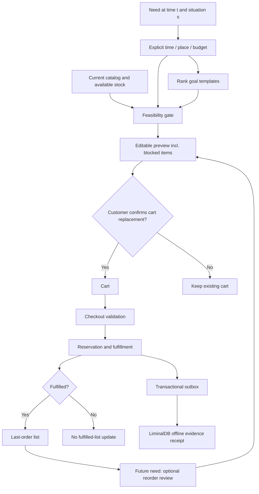

# ROZAL LIFE — time-space causal design v0.2

Product hypothesis, not evidence of actual customer behavior. Based on Club benchmark and the existing demo catalog. No customer location data or actual store sales analyzed.

## Three clocks and two spaces

- Human time: need arises -> plan -> choose -> buy -> use -> need recurs. Morning/evening and weekly planning are explicit choices, not inferred consumption schedules.
- Operational time: catalog read -> reservation -> picking -> fulfillment -> receipt -> possible return. The last fulfilled order is eligible for a reorder preview; a failed or cancelled order is not.
- Evidence time: source commit -> outbox -> offline LiminalDB WAL import -> checked storage receipt. No storage receipt is proof of customer consent, real delivery or payment.
- Physical situations: home, on the way, in store. User selects context, without GPS. Do not infer a route or shelf coordinates. Home: compare pickup/delivery. On the way: consider pickup. In store: review list.
- Digital space: context -> goal templates -> editable draft -> cart -> checkout -> tracking. No automatic checkout or silent replacement.

The arrows are mechanisms or hypotheses. A causal effect on incremental profit requires measurement, not a graph alone.

## Implemented v0.2

- Transparent ranking score: time matches weight 4 then 3, situation matches weight 2 then 1. Feasible goals always rank before infeasible goals; ties keep original catalog template order.
- Time options: any, morning, daytime, evening, weekly plan. Situation options: any, home, on the way, in store. Defaults are neutral. Both are ephemeral; no location permission, automatic profiling, notifications or background timers.
- Optional product budget is shared between ranking and editable preview; includes product costs only, not shipping. Price/stock come from the catalog currently loaded in the client. Blocked goals remain reviewable, never silently remove missing items.
- Explicit prompt for contextual pickup comparison is advice, not an ETA, route, reservation or automatic mode selection.
- Pure frontend rules, no extra packages or paid API. No backend loyalty, auth or reward balances. Existing checkout still needs price-change reconfirmation under concurrent changes.

## Next causal loops (not implemented)

| Intervention | Mechanism to test | Leading indicator | Guardrail |
|---|---|---|---|
| Favorite SKU, user-chosen | less decision friction and relevant benefit | repeat purchase of eligible SKU | gross margin floor, cap, opt-in, no stacking |
| User-chosen replenishment cadence | recall when a need is likely | reviewed reorder rate | opt-out, no guess of household consumption |
| Request missing item | explicit demand -> procurement decision | filled requests / distinct requester count | minimum volume, supplier cost, no fake stock |
| Pickup readiness | reduce wait and uncertainty | on-time pickup | staff capacity, no unsupported ETA |
| Safe surplus | reduce expiry loss | sold surplus vs eligible stock | verified expiry, storage safety, allergens |

For a real pilot: measure contribution per eligible session, completed order rate, D30 repeat, cancellation, and stockouts; pre-register treatment/holdout and definitions; include campaign, delivery and fulfillment costs. Low volume pilots should prioritize operational acceptance and interviews, not claims of statistically significant causal uplift. Do not store purchase profiles in LiminalDB; use minimal non-PII evidence with a retention policy. No shared cross-brand identity without explicit permission and separate data governance.

## Acceptance and QA

No GPS/network dependency for rankings. TR/RU/EN labels. Morning, evening, neutral ordering, insufficient stock, and budget-gate tests; preserve existing list edits and current cart until user applies. Verify mobile at 360 px, keyboard navigation, contrast, static vs local backend, and no restaurant/kiosk regressions before merge. Exact-head CI required.

## Rhythm & Favorite v0.3

Two user-controlled feedback loops now exist in the browser:
- Favorite SKU -> explicit preference -> quick review of current product -> editable draft -> explicit cart replacement. The favorite does not grant a discount, points, a price guarantee or a reservation. No server-side financial effect.
- Saved/last fulfilled list -> frozen list snapshot + chosen first date + 1–90 calendar-day interval -> review due when the app is opened/focused -> validate current catalog/price/stock/budget -> explicit cart replacement if desired. The user may acknowledge a due review separately; the next date is the actual acknowledgement date plus interval. No backlog of orders, no inferred consumption, no background timers, no emails/push/SMS.
- Date calculations are civil calendar days, not elapsed local hours; today comes from the browser local calendar, not physical location. Focus/visibility refresh updates today; a continuously open focused page may need refresh after midnight.
- Browser-local preference storage is isolated between static and API modes. Separate clear controls remove preference records and saved/last lists; deleting source lists does not silently delete the separate rhythm snapshot. The user can remove the plan itself. Storage errors are visible on write; no remote account, cross-device synchronization, demographics or real customer data.
- Existing stock/price checks and explicit checkout remain mandatory. A preference is not evidence of external consent or payment. Nothing from this module is sent to LiminalDB.
- Next financial gate: authenticated member/store, user opt-in, versioned non-stacking offer, conservative available-lot margin check at redemption, transactional reward budget, refund/reversal rules and idempotency. Do not activate discounts before these exist.
- Tests cover invalid dates, leap day, interval bounds, date rollover, snapshot independence, premature acknowledgement and malformed preference state. Require exact-head CI and browser regression.
