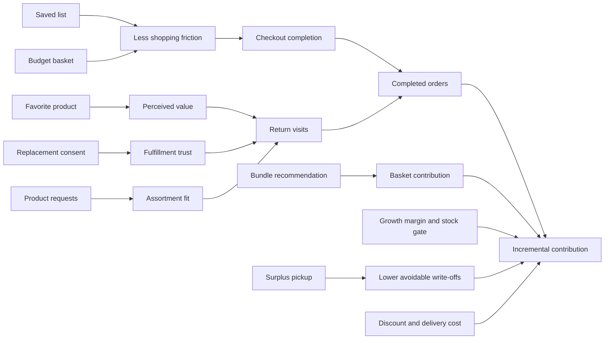

# BiteOS Club & Everyday Commerce — world benchmark, 2026-11-14

Desk research of public product documentation; not an installed-app usability test or a claim of measured conversion lift. Features vary by market. Proposed Rozal features are hypotheses; no merchant consent, real pricing or customer data assumed.

## Benchmark: documented capabilities

| Reference | Observed feature | Adaptation |
| --- | --- | --- |
| Amazon Alexa for Shopping (Nov 2026) | Text-driven shopping, recipes, reorders and shopping assistance | Goal-to-basket, with explicit review before checkout |
| Instacart Clementine (Sep 2026) | Conversation/list/recipe to personalized cart | Local recipe template plus budget and stock checks |
| Walmart | Purchase history reorder, item-level substitution choice | Editable reorder preview, opt-in substitutions |
| Tesco Clubcard (updated Oct 2026), Lidl Plus | Activate coupons, store redemption, digital receipts | QR member identification; no mandatory subscription |
| VkusVill | Favorite product, selected offers, colored labels and combos | One favorite eligible SKU; discount limited by Growth margin and budget |
| Migros Money | Online/in-store loyalty and benefits | Turkish-first member journey, optional TR/RU/EN UI |
| Too Good To Go (Jan 2026) | Reserve surplus bag in collection window | Safe/verified surplus, disclose allergens, quantity, expiry and pickup |
| Ozon | Reorder available items and back-in-stock alert | Editable saved list, request restock opt-in |
| Big C Thailand (May 2026) | Goal-oriented recipe basket assistant | Rule-based intent templates, no paid LLM dependency |

## Priority (qualitative product judgement, not market rankings)

Score = customer value (1–5) + commercial potential (1–5) + implementation feasibility (1–5). Ties: operational prerequisites first. Risk gates override score. Estimate only, validate with real pilot.
| Priority | Feature | Value | Business | Feasibility | Total |
| --- | --- | --- | --- | --- | --- |
| P0 | Saved editable lists / reorder preview | 5 | 5 | 5 | 15 |
| P0 | Budget-based breakfast/dinner baskets | 5 | 5 | 4 | 14 |
| P0 | Favorite eligible product | 5 | 4 | 4 | 13 |
| P0 | Item-level replacement consent | 5 | 4 | 4 | 13 |
| P1 | Missing product request / arrival alert | 4 | 4 | 4 | 12 |
| P1 | Digital receipts and POS coupon redemption | 4 | 5 | 3 | 12 |
| P1 | Safe surplus pickup | 4 | 4 | 3 | 11 |
| P2 | Optional recipe/chat assistant | 4 | 4 | 2 | 10 |

## Causal hypothesis graph

Arrows express hypotheses, not empirical causal proof. Measure conversion from eligible sessions, fulfilled orders per active opt-in member, D30 repeat, contribution per eligible session (including delivery and promo costs), substitutions accepted, cancellation rate, sell-through/spoilage. Distinguish UTM/referral sources and test treatment against a randomized holdout when sample size permits; low-volume pilot first validates operations and customer interviews, without statistical claims.

## Visual system (proposed, not sampled competitor UI)

Rozal brand red #B3263B primary calls to action, warm ivory #FFF8F0 background, dark ink #242323 for text, deep green #246747 for positive savings/freshness, amber #A45B12 for time-limited offers. Text/icon labels in addition to color; WCAG AA contrast validation before release. No dark patterns, forced countdowns, fake discounts or addictive streaks. Use real licensed product photography, clear original/discount price, unit price and availability.

## Delivery order / no paid integrations

1. Local-first saved shopping lists and editable reorder draft. Recheck current SKU stock/prices; do not silently substitute, drop or submit. Browser demo uses only anonymous local preferences.
2. Curated goal baskets (e.g. family breakfast, school lunch, weekly essentials). Explicit quantities and budget check; never infer allergies or health claims. Go rule engine and existing catalog.
3. Favorite SKU and opt-in loyalty ledger; server-owned member and store identity, one non-stacking benefit, consent/expiry, atomic redemption and maximum available-lot-cost Growth gate. Real rewards cannot be activated until auth, refund rules, budget caps and legal review exist.
4. Item substitution consent with price ceiling, original/replacement line audit and stock revalidation. Request missing assortment and opt-in alerts (in-app first; SMS optional, potentially paid).
5. POS reconciliation / digital receipts (not fiscal receipts until local requirements are met), expiry lots and safety checks before surplus offers.

SQLite for identity/order/reward transactions; Go for rules; LiminalDB for minimal non-PII evidence only; React for accessible PWA; existing SQL projections first, DuckDB optional for analytics. No new dependencies introduced by this document. A local LLM is optional, not required; do not authorize purchases from unverified generated output. Turkish KVKK, electronic marketing permissions, consumer protection and fiscal/food rules need independent review before a real pilot. No merchant brands or photos copied from references.

## Public sources

- https://www.aboutamazon.com/news/retail/alexa-for-shopping-text-to-shop (2026-11-06, updated 2026-11-13)
- https://company.instacart.com/pressreleases/meet-clementine-instacart-s-ai-shopping-assistant-that-takes-what-s-for-dinner-off-your-plate (2026-09-09)
- https://www.walmart.com/help/article/reorder/8c2a6854a3e9428faa93836347c46dd2
- https://www.walmart.com/cp/3893115
- https://www.tesco.com/help/pages/clubcard-faqs/clubcard-coupons/adding-coupons-to-your-clubcard-to-use-in-store (updated 2026-10-16)
- https://www.lidl.com/c/lidl-plus-faqs/s10097623
- https://vkusvill.ru/support/programma-loyalnosti/lyubimyy-produkt/
- https://vkusvill.ru/legal/pravila-programmy-loyalnosti/
- https://www.migroskurumsal.com/sikca-sorulan-sorular
- https://tgtg.zendesk.com/hc/en-us/articles/27734974995602-How-do-I-make-an-order-on-Too-Good-To-Go (updated 2026-01-30)
- https://docs.ozon.ru/common/moj-zakaz/pochemu-moj-zakaz-otmenili/
- https://press.aboutamazon.com/aws/2026/5/bjcs-big-c-launches-shopping-assistant-ai-chat-on-aws-bringing-conversational-shopping-to-customers-across-thailand
- https://www.igd.com/commercial-insight/retail-analysis/futures/articles/ai-assistants-are-grocerys-new-loyalty-engine/74202 (2026-10-05)
- https://www.igd.com/commercial-insight/retail-analysis/trends/articles/how-retailers-are-taking-their-apps-beyond-loyalty-discounts/73720 (2026-07-29)
