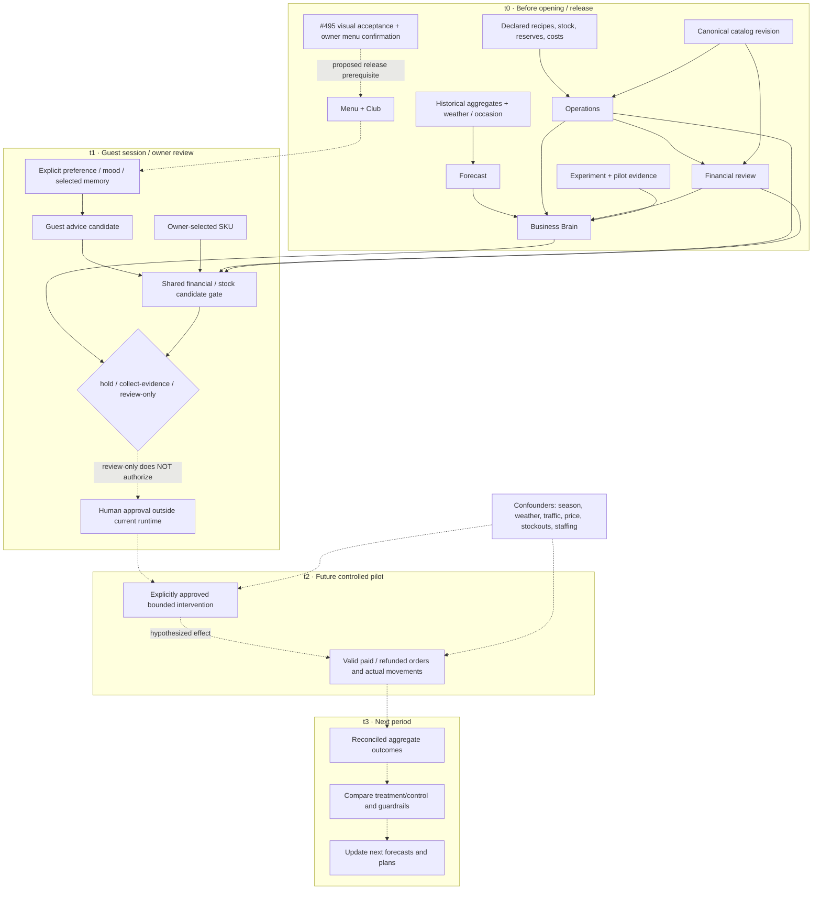

# Roby's / BiteOS — temporal causal graph and spatial decision matrix v0.1

Snapshot: 2026-11-16, Europe/Istanbul (UTC+03). Architecture and release decision record, not runtime functionality, production approval or measured causal impact. All horizons below are proposed operating cadences, not deadlines or observed durations.

## Evidence baseline

- BiteOS PRs [#1](https://github.com/safal207/biteos/pull/1) → [#2](https://github.com/safal207/biteos/pull/2) → [#3](https://github.com/safal207/biteos/pull/3) → [#4](https://github.com/safal207/biteos/pull/4) → [#5](https://github.com/safal207/biteos/pull/5) → [#6](https://github.com/safal207/biteos/pull/6) → [#7](https://github.com/safal207/biteos/pull/7) are stacked, open drafts, not merged at the snapshot. The preceding audit returned three successful workflow runs for each of seven commit heads (21 runs; this is not a count of tests). PR #7 pinned head eebfc9f38d8507b7ee8ac4532745057ae79b1c68: [check](https://github.com/safal207/biteos/actions/runs/43846279275), [browser smoke](https://github.com/safal207/biteos/actions/runs/43846279283), [LiminalDB compatibility](https://github.com/safal207/biteos/actions/runs/43846279344). Browser smoke covers existing bundle / local pilot, not a new Living Business UI.
- Roby's [#495](https://github.com/safal207/robys-coffee-house-demo/pull/495), head 0712716fb7bd91fd8b0641621ef6048b5b708dec: [VISUAL-001](https://github.com/safal207/robys-coffee-house-demo/actions/runs/43721992774) failed at reviewed visual change validation; downstream UI/UX checks skipped; cannot infer a CSS defect from this alone. Owner approval, mobile acceptance, profile, catalog/photo rights/price/hours verification remain open.
- Roby's [#505](https://github.com/safal207/robys-coffee-house-demo/pull/505), head 3d1f251ebf362009273b0c0c437f4076171b48de: [menu performance](https://github.com/safal207/robys-coffee-house-demo/actions/runs/43844847973) passed; visual regression also passed at that head; human approval skipped. Offline mood preview only, provider controls disabled. No playback, licensing sign-off or production activation.
- Source anchors at PR #7 head: [Business Brain](https://github.com/safal207/biteos/blob/eebfc9f38d8507b7ee8ac4532745057ae79b1c68/apps/kiosk/src/robysBusinessBrain.ts), [shared offer gate](https://github.com/safal207/biteos/blob/eebfc9f38d8507b7ee8ac4532745057ae79b1c68/apps/kiosk/src/robysLivingOffers.ts), [owner review](https://github.com/safal207/biteos/blob/eebfc9f38d8507b7ee8ac4532745057ae79b1c68/apps/kiosk/src/robysBusinessOfferReview.ts). Synthetic and declared data; no real revenue, verified stock, tax, net profit, causal uplift or authorization.

## 1. Temporal graph

Solid arrows = implemented computation/gating at inspected draft head or documented release dependency; dashed arrows = proposed behavior or causal hypothesis, not verified by CI. The feedback loop is unfolded across time slices so the graph is acyclic. Owner input is isolated from personal guest memory.

The diagram is a conceptual union of two distinct call paths, not an assertion that guest advice is called by owner review. Explicit device memory feeds only the guest path; an owner-selected SKU and tenant-scoped operator declarations feed the owner path. Existing Business Brain holds and collection tasks short-circuit the owner candidate before the shared gate. No personal journal/identity flows to the owner. The guest UI, real event transport, payment reconciliation and experiment feedback arrows remain proposed.

## 2. Spatial decision matrix

Space means bounded operational surfaces (device, menu, counter, kitchen, finance, owner workspace, QA/release), not tracked physical location. Every record must be scoped by tenant, catalog revision, relevant time window and non-personal source IDs. Actual timestamps are not synthesized.

| Decision | Time / horizon | Space / accountable role | Trigger / causal antecedent | Evidence and guard | Disposition / action | Verify / stop |
|---|---|---|---|---|---|---|
| D01 | Before release (now) | QA / web menu | #495 visual validator failed | exact-head screenshots, reviewed change artifact, manual 320px/TR-EN-RU device checks | HOLD public handoff as release-ready; inspect evidence and resolve actual mismatch; owner sign-off | rerun same-head/revised-head relevant CI; no blanket baseline update |
| D02 | Before release (now) | Engineering / BiteOS | 7 stacked drafts, CI green | each base/head, independent review, path dependencies incl. #1 retail; new exact-head runs after rebase | REVIEW stack; separate unrelated retail scope if justified; no auto-merge | required checks and stack integration matrix |
| D03 | Before release (now) | QA / Sounds | #505 prior performance concern | exact-head perf success; visual success; approval skipped | REVIEW offline demo only | retest if head changes; provider gate stays closed |
| D04 | Before opening (daily) | Kitchen / stock owner | forecast and ingredient plan disagree or stock shortage/hold | reconciled units, recipe revision, lots, reserves, spoilage/expiry, current day | hold unavailable/unsafe candidates; collect missing inputs; human stock adjustment | actual inventory and reserve after planned demand; no unsafe substitution |
| D05 | Before opening (daily) | Finance / owner | missing or invalid cost inputs / low contribution | source-valid unit costs, currency minor units, discount, campaign cap; declared reserve; selected SKU | collect or hold; otherwise review-only | actual invoices/tax/fees and refunds; do not label contribution net profit |
| D06 | During session (seconds) | Guest device / Club | explicit preference or mood selection | choice / opt-out; eligible catalog, budget and safety; valid selected memory only | show optional eligible suggestion or abstain | no unsolicited app scanning, no guest identity or journal sent to owner |
| D07 | During shift (minutes) | Counter / kitchen | validated order / cancel / refund (future input) | idempotent event IDs, tenant scope, paid/cancelled/refunded state, order and stock reconciliation | proposed stock reconciliation, not automatic recipe/price change | double-count, stale plan, correction and refund checks |
| D08 | Daily review | Owner / Business Brain | experiment, operations, financial, forecast or pilot evidence | existing same-bundle review, current Istanbul day/catalog revision | HOLD > COLLECT > REVIEW; only after review-only evaluate shared candidate | no campaign dispatch, price change, or causal claim |
| D09 | Future approved pilot (7–14 day proposal, not adequacy claim) | Menu + counter / owner and analyst | hypothesis about eligible add-on or combo | separately approved protocol; predeclared assignment, sample size, outcome/guardrails, verified data | limited randomized test if approved; otherwise do not launch | allocation mismatch, refund/stockout harm or guardrail breach → stop |
| D10 | Weekly / next period | Owner / analytics | reconciled outcomes available | contribution per eligible order, demand error, refunds, waste, assignment and missingness | review effect estimates and uncertainty; decide keep, revise or rollback | nonrandomized comparisons remain associations; do not treat popularity as profit |
| D11 | Multi-site (later) | Tenant boundary / platform | second store onboarding | scoped catalogs, tenant isolation, currencies, consent rules, access tests | collect evidence; isolate pilot per location | no cross-tenant guest/financial leakage or pooled claims without comparable definitions |

Existing priority: Business Brain sorts HOLD before COLLECT before REVIEW and then source order experiment → operations → financial → forecast → pilot, with code tie-break. D01–D03 are release process gates outside this runtime. For D04–D11, cadence and role allocation are recommendations, not implemented scheduling/RBAC.

## 3. Evidence and causality rules

Decision identity (proposed, not a new protocol): decision ID, tenant ID, operational surface, event/as-of time with timezone, observation window, catalog/source revisions, source evidence links, reason codes, state, accountable human, authorization state, expected effect and rollback/verification rule. Separate event time from ingestion, decision and action time. Late corrections create a new decision record linked to the previous one; never silently overwrite evidence. Avoid guest identifiers or device journals in owner records. Consent withdrawal does not imply deletion of earlier imports; retention/deletion governance is still open.

Leading vs lagging: impressions/clicks/suggestions are engagement signals, not purchases; paid/refunded orders with reconciled amounts are outcomes. Contribution = net-of-discount sales basis minus applicable variable cost, with exact accounting policy, tax, fees, refunds and campaign spending reconciled before reporting actuals. Existing code uses declared scenario contribution, not accounting profit. No actual numeric values or assumed uplift are supplied here.

Proposed controlled test: compare business-approved eligible offer vs unchanged menu, assign eligible units consistently, record exposure, analyze intention-to-treat at the predeclared unit; use contribution per eligible order (or per assigned session when non-order sessions must count) and predeclare denominator before launch. Guardrails: stock/reserve, refunds/complaints, eligibility, privacy, margin and spend. Control for contamination, shift/weekday, weather, season, pricing, availability and staffing. No effect size/sampling duration claim without baseline variance and power calculation.

## 4. Next integration sequence

1. P0: recover #495 screenshot/approval evidence, determine whether intended change or true defect; resolve with reviewed artifact + mobile acceptance and Reyhan approval. Keep basic menu delivery independent of experimental features.
2. P0 parallel: review BiteOS PR #1–#7 stack, explicitly assess unrelated Retail dependency; consolidate overlapping drafts only after review and repeat checks on changed heads.
3. P1: one offline, synthetic owner scenario (normal, missing data, hold), guest path isolated, verify existing contract from canonical menu to review candidate; no new product module or actual data collection.
4. P1: establish tenant-scoped data source reconciliation, authorization/consent/retention policy and owner acceptance. No runtime activation.
5. P2: only after approvals, propose bounded pilot with predeclared metrics/rollback. No provider access until licensing and separate approval.

Documentation-only snapshot; does not change code, CI, PR #1–#7 heads, or production.
